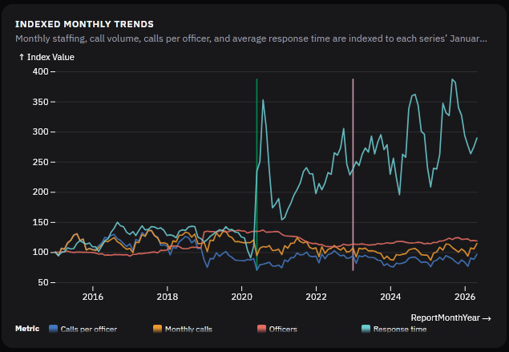
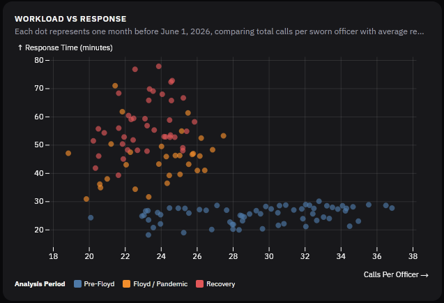

# Portland Police Bureau Response Times

Analysis of how Portland Police Bureau (PPB) response times have changed against officer staffing and call workload, 2015 to 2026.

## Charts

| | |
|---|---|
|  |  |
|  | |

## Repository layout

| Path | Contents |
|---|---|
| `Portland Police.designer.ipynb` | Notebook (Databricks Designer export) that loads the raw data, joins it by month, and builds the summary table |
| `Final Data/PPB-Simple.csv` | Monthly summary: total staff, officers, call counts, and average queue, travel, and response times (seconds) overall and by priority (high, medium, low) |
| `Raw Data/CallsforService/` | PPB dispatched-calls open data, one Excel file per year, 2012 to 2026 |
| `Raw Data/Staffing/` | Redacted PPB personnel records (police actions and EEO report), 2015 to 2026 |
| `Raw Data/FillDates-Month.csv` | Month list used to fill gaps in the monthly series |
| `Research/` | Reports on PPB staffing and recruitment used as background |

## Reproducing

The notebook was built in Databricks and its source paths point at a Databricks volume. To rerun it elsewhere, change the file paths in the `source_*` cells to the files under `Raw Data/`.

## AI disclosure

Claude (Anthropic's AI assistant) was used to help set up this repository: creating the GitHub repo, drafting the initial README, and adding the license files. It was not used for any analysis.

All data collection, analysis, and conclusions were done by hand with non-AI methods. Nothing in the data, the notebook, or the charts was generated or altered by AI. The raw data, the processing steps, and the outputs are all included in this repository so that every result can be audited and replicated independently.

## Licensing

- **Code** (the notebook): [MIT](LICENSE).
- **Original analysis, charts, and `Final Data/PPB-Simple.csv`**: [CC BY 4.0](LICENSE-CC-BY-4.0.txt). Reuse freely with credit to Nick Hara.
- **Third-party material is not covered by either license.** `Raw Data/` and `Research/` come from PPB, the City of Portland, and the authors of the reports, and remain under their original terms.
